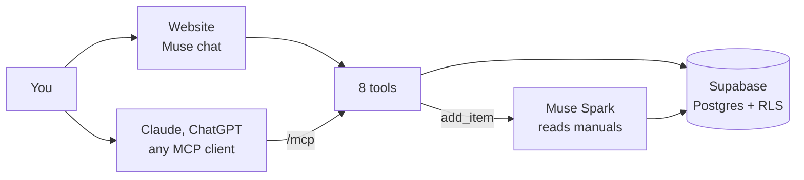

# Manuals

Every manual in the house, one question away.

Add a washer, a dishwasher or a car seat by its model number. Muse Spark reads the manual and saves
what matters: upkeep tasks, error codes, parts, specs and car seat limits, each with its page.
Then ask in plain words, from the website's chat or from Claude or ChatGPT through MCP.

If a fact sounds wrong, say so. The assistant checks the page and fixes it, and the old version
stays in the history. What you say yourself always wins.

Built for the Meta Global AI Developer Hackathon (indie track).



## Tools

| Tool                 | What it's for                                                                 |
| -------------------- | ----------------------------------------------------------------------------- |
| `add_item`           | Add a thing and its manual PDF. Muse reads it into tasks and facts.           |
| `list_items`         | What you own, what's next, and what needs review.                             |
| `ask_manual`         | Answers with page cites: search, exact error codes and specs, the schedule.   |
| `upcoming`           | Tasks due soon, plus facts a person should check.                             |
| `revise_fact`        | Correct or confirm a fact, task or car seat limit, with a reason.             |
| `log_done`           | "I just cleaned the filter" moves the next due date.                          |
| `record_measurement` | A child's height and weight, or a thing's cycle count or hours.               |
| `car_seat_status`    | Which mode fits now and an estimated date for the next change, with the page. |

## Run it

You need [Bun](https://bun.sh), a Supabase project and a Vercel account. Free tiers are enough.

**Supabase**
1. Create a project.
2. Project Settings, JWT Keys: switch to asymmetric signing keys.
3. Authentication, OAuth Server: turn it on, set the authorization path to `/oauth/consent`, and
   allow dynamic client registration.
4. Apply the schema: `supabase link --project-ref <ref>` then `supabase db push`.

**Vercel**
1. Import the repo with Root Directory `server` (framework: Other).
2. Set the variables from [`server/.env.example`](server/.env.example). `READER_*` points at the
   Muse Spark API (any OpenAI-compatible chat API works).
3. In Supabase, Authentication, URL Configuration: set Site URL to the deployment's URL.

**Connect an AI**: add `https://<your-app>.vercel.app/mcp` as a custom connector in Claude
(Settings, Connectors) or ChatGPT (Settings, Apps, developer mode).

## Develop

```sh
bun install
cp server/.env.example server/.env   # fill in your own values
bun run dev                          # http://localhost:3000, MCP at /mcp
bun run check                        # lint, typecheck, tests
```

Database tests run against plain Postgres with a small Supabase stub:

```sh
psql -f supabase/tests/stub_supabase.sql -f supabase/migrations/20261022150000_init.sql -f supabase/tests/rls_test.sql
```

## Notes

- Costs stay flat: each manual is read once, with at most `READER_MAX_CHARS` of text, and each
  household gets `READER_DAILY_LIMIT` reads a day. Token use is saved on each manual:
  `select reader_model, sum(reader_tokens_in), sum(reader_tokens_out) from manuals group by 1;`

- Every database call runs as the signed-in user, so row-level security decides what anyone sees.
  The server never holds a service key.
- Car seat dates are estimates from the WHO Child Growth Standards (2006). The manual and a
  certified child passenger safety technician have the final word.
- Growth tables come from the BSD-licensed `pygrowup` package. Fonts are Atkinson Hyperlegible and
  Bricolage Grotesque under the SIL Open Font License (see [`docs/licenses/`](docs/licenses/)).
